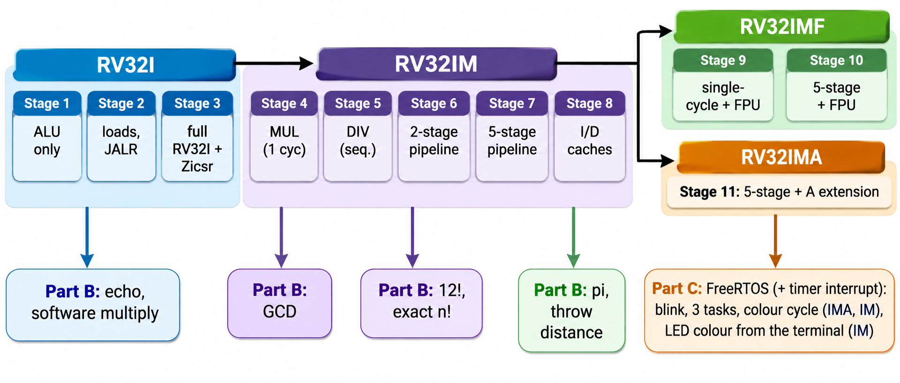

# RISC-V in Chisel: from an RV32I ALU core to FreeRTOS on RV32IMA, on the iCESugar-Pro

This series of Chisel 3 projects builds a RISC-V processor **one idea at a time**, then runs it on a real FPGA board,
the **iCESugar-Pro** (Lattice ECP5 LFE5U-25F). It starts with a single-cycle core that knows only the 19 ALU
instructions (register-register R-type and register-immediate I-type). It ends with a **5-stage pipelined RV32IMA
core with a timer interrupt, running FreeRTOS V11.1.0**, and an application where you choose the colour of the
board's RGB LED by typing on a terminal.

The series has three parts:

- **Part A, the cores (Stages 1 to 11):** eleven cores, each extending a design that already passes all of its tests,
  checked cycle by cycle against an instruction-level reference model.
- **Part B, bare-metal programs on the board (5 projects):** four of these cores, unchanged, in a small system-on-chip
  (ROM, RAM, RGB LED, UART), each with its own demo program written in assembly.
- **Part C, FreeRTOS on the board (5 projects):** the 5-stage core with a machine timer interrupt, 32 KiB of block
  RAM and a CLINT timer, running FreeRTOS applications written in C, on RV32IMA and on RV32IM.

# RISC-V Processor Development

This project presents the progressive development of RISC-V processors.

## Architecture Roadmap




## 1. Common ground

All the projects share the same tools, the same Scala package and the same way of checking the hardware.

| Item | Details |
|---|---|
| Language | Scala 2.13.12, **Chisel 3.6.1** (+ compiler plugin), package `rv32i` |
| Simulation | **chiseltest 0.6.2** on Treadle: pure Scala, no simulator to install |
| Build | **sbt 1.10.2**, Java 11 or newer (tested with Java 21) |
| Verilog | `sbt "runMain rv32i.Emit"`: SystemVerilog through CIRCT firtool 1.37.0 when it is on the PATH, otherwise Chisel 3's built-in compiler |
| Waveforms | VCD files with ready-made **GTKWave** sessions (`.gtkw`), registers in decimal, instruction words shown as assembly |
| FPGA flow | Chisel → **Yosys** → **nextpnr-ecp5** → **ecppack** (oss-cad-suite, or the Python YoWASP builds) |
| Firmware (Part C) | **clang / ld.lld** with the RISC-V target (or a GNU RISC-V toolchain), FreeRTOS V11.1.0, Python 3 |

Every core has the same outside interface: an instruction port, a data port and a **retirement trace** (one record per
cycle: pc, next pc, instruction, register written, memory access, trap and cause). This is what makes the series work:
the same reference model and the same tests carry over from one stage to the next, so each step only changes the
hardware it is about.

### How every stage is verified

1. **Unit tests** for each block: all ALU operations on edge values and thousands of random operands, every immediate
   format, every divider corner case, the caches against a directory model, the FPU bit for bit against a reference.
2. **Lockstep program tests:** the core runs next to `RefModel`, an instruction-level model in Scala, and the trace is
   compared **every cycle**. Directed programs (loops, dependency chains, every exception type) plus random programs of
   3,000 instructions.
3. **Timing tests** pin the exact cycle cost of each case: one instruction per clock, the divider's extra cycles,
   pipeline fill, bubbles per branch and load-use, cache freezes, FPU latencies.
4. **Planted bugs** prove that the tests catch real faults: SRA decoded as SRL, a register written during a cache
   freeze, a cache hit that ignores the tag, an f result not forwarded, and so on. Each one must make the suite fail.

---

## Part A: the cores, Stages 1 to 11

### 2. Stages 1–5: single-cycle cores, growing the instruction set

Every instruction completes in one clock cycle, except a division.

1. **Stage 1, RV32I ALU core** (`rv32i-stage1`). The 10 R-type instructions (ADD, SUB, SLL, SLT, SLTU, XOR, SRL,
   SRA, OR, AND) and the 9 I-type ALU instructions (ADDI … SRAI). Blocks: ALU with 10 operations, decoder,
   sign-extended I immediate, 32 × 32 register file with x0 hard-wired to zero. The pc always advances by 4. It also
   writes one Verilog file per module, each with its own self-checking testbench for Icarus Verilog or Verilator.
2. **Stage 2, loads and JALR** (`rv32i-stage2`). A read-only data memory, the five loads (LB, LH, LW, LBU, LHU) with
   byte and half-word alignment, and JALR, the first instruction that changes the pc. 25 instructions.
3. **Stage 3, complete RV32I + Zicsr** (`rv32i-stage3`). All 40 RV32I instructions: stores with byte strobes, the six
   branches, LUI, AUIPC, JAL. The six CSR instructions, MRET and WFI, and **precise machine-mode traps**: illegal
   instruction, ECALL, EBREAK, misaligned fetch, load and store, with mtvec, mepc, mcause, mtval, and the counters
   mcycle and minstret.
4. **Stage 4, multiplication** (`rv32im-stage4`). A combinational 33 × 33 multiplier executes MUL, MULH, MULHSU and
   MULHU in the same single cycle. Division is still an illegal instruction.
5. **Stage 5, RV32IM complete** (`rv32im-stage5`). A sequential divider (one quotient bit per cycle) adds DIV, DIVU,
   REM and REMU: 34 cycles, or 2 for divide-by-zero and signed overflow, with the results the RISC-V specification
   defines. misa reads `0x40001100`.

### 3. Stages 6–8: pipelines and caches, same instruction set

With RV32IM complete, the next three stages keep the ISA and rebuild the microarchitecture for speed. The reference
model and all the program tests carry over unchanged.

6. **Stage 6, 2-stage pipeline** (`rv32im-stage6`). IF fetches into the `IfEx` register; EX does everything else.
   Branches are predicted not taken: a taken branch, jump, trap or MRET flushes the fetched instruction (1 bubble).
7. **Stage 7, 5-stage pipeline** (`rv32im-pipe5`). IF, ID, EX, MEM, WB with registers `IfId`, `IdEx`, `ExMem`,
   `MemWb`. Forwarding from MEM and WB plus a WB→ID bypass remove most stalls. A load followed by a user of its value
   costs 1 cycle, a redirect (resolved in EX) 2, the pipeline fill 4. Exceptions stay precise: they are taken in EX,
   older instructions drain, younger ones are flushed. **This pipeline is the base of Stage 11 and of all of Part C.**
8. **Stage 8, 5-stage pipeline with caches** (`rv32im-stage8`). A 1 KiB direct-mapped I-cache and a 1 KiB
   direct-mapped, write-through, no-write-allocate D-cache in front of main memories with a 4-cycle latency. While
   either cache is busy the whole pipeline freezes; the divider keeps working.

### 4. Stages 9–10: the F extension

9. **Stage 9, single-cycle RV32IMF** (`rv32imf-stage9`). The Stage 5 core plus the **F extension**: 32
   floating-point registers, `fcsr` (`frm`, `fflags`), and all 26 single-precision instructions, IEEE 754 binary32 with
   the five rounding modes and the five exception flags. Sign injection, compares, min/max, classify and moves are
   combinational; FADD/FSUB (6 cycles), FMUL and the fused multiply-adds (30), FDIV/FSQRT (32) and the conversions
   (4–5) use a sequential FPU, checked bit for bit, flags included, against a separate Scala reference.
10. **Stage 10, 5-stage pipelined RV32IMF** (`rv32imf-stage10`). The Stage 9 instruction set on the Stage 7 pipeline.
    The FPU sits in EX and freezes IF/ID/EX for its latency while MEM and WB drain; f results are forwarded like
    integer results.

### 5. Stage 11: the A extension

11. **Stage 11, 5-stage pipelined RV32IMA** (`rv32ima-pipe5`). The Stage 7 core plus the **A extension**: LR.W,
    SC.W and the nine AMO*.W instructions (SWAP, ADD, XOR, AND, OR, MIN, MAX, MINU, MAXU). misa reads `0x40001101`.
    - An AMO reads the old word and writes the new one **in the MEM stage, in one cycle**: the data port reads
      combinationally and writes at the clock edge, and the core is the only master, so nothing can come between them.
    - For hazards an AMO behaves like a load: an instruction that uses its result right behind waits one cycle.
    - One reservation (a word address), set by LR.W and cleared by every SC.W, every trap and every MRET.
    - Misaligned LR.W traps with cause 4, misaligned SC.W or AMO with cause 6. The aq/rl bits have no effect on this
      in-order core with one data port.

### 6. The eleven stages side by side

| Stage | Project | ISA | New hardware | Cycle cost | Tests |
|---|---|---|---|---|---|
| 1 | `rv32i-stage1` | 19 ALU instructions (R-type + I-type) | ALU, decoder, immediate, register file | 1 per instruction | 32 |
| 2 | `rv32i-stage2` | + 5 loads, JALR | read-only data memory, load alignment | 1 | 33 |
| 3 | `rv32i-stage3` | RV32I + Zicsr | stores, branches, jumps, CSR file, precise traps | 1 | 30 |
| 4 | `rv32im-stage4` | + MUL, MULH, MULHSU, MULHU | combinational 33 × 33 multiplier | 1 | 34 |
| 5 | `rv32im-stage5` | RV32IM + Zicsr | sequential divider | 1; DIV/REM 34 | 47 |
| 6 | `rv32im-stage6` | same | 2-stage pipeline IF \| EX | + 1 per redirect; DIV/REM + 33 | 48 |
| 7 | `rv32im-pipe5` | same | 5-stage pipeline, forwarding, load-use stall | fill 4; load-use + 1; redirect + 2 | 37 |
| 8 | `rv32im-stage8` | same | I-cache, D-cache, slow main memories, freeze | + refill (≈ 6) per miss, + ≈ 5 per store | 52 |
| 9 | `rv32imf-stage9` | RV32IMF + Zicsr | FP register file, fcsr, FPU | 1; FPU 4 to 32 | 69 |
| 10 | `rv32imf-stage10` | same | FPU in the 5-stage pipeline, f forwarding | as Stage 7, + FPU latency | 70 |
| 11 | `rv32ima-pipe5` | RV32IMA + Zicsr | atomic read-modify-write in MEM, LR/SC reservation | as Stage 7; AMO like a load | 44 |

Test counts are from the last full `sbt test` run of each project. Two earlier variants are also in the folder:
`rv32im` (the first single-cycle RV32IM) and `rv32im-pipe2` (its first 2-stage pipeline). Stages 5 and 6 supersede
them.

### 7. Working with a stage

From any stage folder:

```bash
sbt test
```

```bash
sbt "testOnly rv32i.CoreProgramSpec"
```

```bash
sbt "runMain rv32i.Emit"
```

The first runs every test, the second one suite, the third writes SystemVerilog to `generated/`. Each project's
`README.md` lists its files, the core's ports and its waveform demos; `DESIGN_NOTES.md` explains the datapath, the
hazards and every design choice.

---

## Part B: bare-metal programs on the iCESugar-Pro

### 8. The bare-metal board system

Every Part B project puts a core, **unchanged**, in the same small system, so a program written for one runs on the
others (as long as it uses only the instructions that core has).

| Block | Details |
|---|---|
| FPGA | Lattice ECP5 **LFE5U-25F-6BG256C** (24k LUTs) on the iCESugar-Pro |
| Clock | 25 MHz oscillator (P6); a PLL (`pll25to12p5.v`) makes 12.5 MHz for the cores whose critical path needs it |
| Instruction ROM | at 0x80000000, a constant table in LUTs: 256 or 512 words |
| Data RAM | 4 KiB at 0x80010000 |
| RGB LED | red B11, green A11, blue A12, active-high (measured on a real board with the pin test) |
| UART | 115200 baud 8N1 on the iCELink USB serial port: FPGA TX = B9, RX = A9 |

The cores are Harvard machines here: they cannot read data from the ROM, so every program first builds its strings
and tables in RAM. The programs are written in Scala with the projects' own small assembler (`Asm.scala`).

### 9. The five bare-metal projects

| Project | Core | Clock | Demo programs | Resources | Max. frequency |
|---|---|---|---|---|---|
| `rv32i-icesugar-pro` | Stage 3, RV32I single-cycle | 12.5 MHz | echo + RGB LED; **multiplication in software** (`-mul`) | 7,371 LUT4 | 23.26 MHz |
| `rv32im-pipe5-icesugar-pro` | Stage 7, RV32IM 5-stage | 25 MHz | echo + 12!; **exact n! up to 999!** (`-fact`) | 7,980 LUT4, 4 MULT18X18D | 37.95 MHz |
| `rv32im-pipe2-icesugar-pro` | Stage 6, RV32IM 2-stage | 12.5 MHz | **greatest common divisor** (Euclid, every step printed) | 12,076 LUT4, 4 MULT18X18D | 23.22 MHz |
| `rv32imf-pipe5-icesugar-pro` | Stage 10, RV32IMF 5-stage | 12.5 MHz | **pi** in single precision, three ways | 14,412 LUT4, 4 MULT18X18D | 25.82 MHz |
| `rv32imf-pipe5-icesugar-pro-throw` | Stage 10, RV32IMF 5-stage | 12.5 MHz | **throw distance** R, T, H from speed and angle | 14,473 LUT4, 4 MULT18X18D | 27.13 MHz |

All pass timing with Yosys 0.71 and nextpnr-ecp5 0.11.1. The 5-stage integer core runs at 25 MHz; the single-cycle and
2-stage cores (all the work in one stage) and the FPU core (a long EX stage) run at 12.5 MHz.

---

## Part C: FreeRTOS on the iCESugar-Pro

### 10. What FreeRTOS needs, and what was added

An operating system needs things the bare-metal system did not have. Part C adds them around the Stage 11 core
(RV32IMA), and later around an RV32IM copy of it:

| Need | Added | Why |
|---|---|---|
| A periodic tick | the **machine timer interrupt** in the core (mie.MTIE, mip.MTIP, mstatus.MIE/MPIE), taken in EX, precise, checked in lockstep against the reference model (`CoreIrqSpec`) | the scheduler switches tasks on each tick |
| A timer | a **CLINT**: mtimecmp at 0x02004000, mtime at 0x0200BFF8 (the standard addresses the FreeRTOS RISC-V port uses), mtime counting at 1 MHz | the tick is programmed in mtimecmp |
| Code that reads its own constants | **one 32 KiB RAM at 0x80000000** for code and data, with two read ports (fetch and data) | compiled C loads constants and initialised data from the program image |
| Room for a kernel, heaps and stacks | the RAM is built from **32 DP16KD block RAMs**, loaded with the firmware by the bitstream | 32 KiB do not fit in LUTs |

The system clock is the 25 MHz oscillator, used directly. The LED and UART registers are those of Part B:

| Address | Register | Access |
|---|---|---|
| 0x10000000 | LED: bits 2:0 = {blue, green, red}, 1 = on | read/write |
| 0x10000004 | UART_TX: byte to send (only when UART_STATUS bit 0 = 1) | write |
| 0x10000008 | UART_STATUS: bit 0 = transmitter ready, bit 1 = a received byte is waiting | read |
| 0x1000000C | UART_RX: the received byte; reading it clears UART_STATUS bit 1 | read |
| 0x02004000 / 0x0200BFF8 | CLINT mtimecmp / mtime (64 bits each) | read/write |

The firmware (`firmware/` in each project) is FreeRTOS V11.1.0 with its RISC-V port unchanged, start-up code, a linker
script, a small C library and the application. FreeRTOS settings: preemptive, tick 100 Hz (10 ms = 250,000 clock
cycles), heap_4, stack overflow checking, assertions on. If all three LED colours **blink fast together**, the
firmware has stopped on a fault (failed assertion, stack overflow, out of heap or an unexpected exception).

### 11. The five FreeRTOS projects

| Project | Core | Application | FreeRTOS features used | Logic cells | Max. frequency |
|---|---|---|---|---|---|
| `rv32ima-freertos-icesugar-pro` | RV32IMA | **Blink:** three copies of one task toggle red (0.5 s), green (0.75 s) and blue (1.25 s); all 8 colour mixes, every 15 s | `vTaskDelayUntil`, priorities; each toggle is one **AMOXOR.W** | 9,022 | 38.95 MHz |
| `rv32ima-freertos-3tasks` | RV32IMA | **Three independent tasks:** red heartbeat, blue counter (1–4 flashes), green "breathing" | `vTaskDelayUntil`, `vTaskDelay`, a never-blocking task with software PWM from mtime; **AMOOR.W / AMOAND.W** | 9,088 | 38.80 MHz |
| `rv32ima-freertos-colour-cycle` | RV32IMA | **Colour cycle:** red 2 s, off 1 s, green 2 s, off 1 s, blue 2 s, off 1 s | three tasks pass a turn in a ring with **task notifications** | 9,138 | 40.66 MHz |
| `rv32im-freertos-colour-cycle` | **RV32IM** (A removed) | the same colour cycle | the same; no atomic instruction anywhere | 8,410 | 40.07 MHz |
| `rv32im-freertos-uart-led` | **RV32IM** | **LED colour from the terminal:** type `red`, `g`, `red+blue`, `110`, `status`, `help` … | a **queue** of lines, a reply queue, task notifications, two tasks | 8,450 | 39.28 MHz |

All use 32 of the 56 DP16KD block RAMs and 4 MULT18X18D, and pass timing at 25 MHz.

#### Why FreeRTOS does not need the A extension

FreeRTOS runs here on a single core (one hart). The kernel protects its lists and counters by switching interrupts off
for a few instructions (`portDISABLE_INTERRUPTS` is `csrc mstatus, 8` in the RISC-V port). With one hart and no
interrupt, nothing can run between a read and the write that follows it. So neither the kernel nor the port uses an
atomic instruction.

The first two RV32IMA examples use AMOs only in the **application**, so that several tasks can change bits of the
same LED register without a critical section. The colour cycle has only one writer at a time and needs none. The two
RV32IM projects make this explicit:
- the decoder no longer knows the AMO opcode (LR, SC and AMO trap as illegal instructions);
- the read-modify-write path and the reservation are gone;
- misa reads `0x40001100`, and the firmware is compiled with `-march=rv32im`.

The system then needs 654 fewer LUT4 (8 %).

#### The terminal application (`rv32im-freertos-uart-led`)

| You type | LED |
|---|---|
| `off red green blue yellow cyan magenta white` | that colour |
| any unique start of a name, upper or lower case (`g`, `BLUE`, `mag`) | that colour |
| `red+blue`, `green, blue`, `red green` | the colours mixed |
| three binary digits R G B (`110`) | yellow |
| `status` / `help` or `?` | current colour / the command list |

Backspace, Delete and Ctrl-U edit the line; arrow keys are ignored; an unknown word is reported and leaves the LED
unchanged. The design:
- A **console task** reads the UART, echoes, edits the line and sends the replies. The core has no UART interrupt and
  the receiver holds one byte, so this task polls the UART continuously.
- An **LED task** parses each finished line, sets the LED and writes the reply.
- Lines go from the console to the LED task through a queue **by index** into a set of line buffers, and replies come
  back **by pointer**. The console therefore never stops reading for long: even when a whole session is pasted at
  115200 baud, every byte is read before the next one arrives.

### 12. How the FreeRTOS projects were checked

1. **The core:** the core test suites, including `CoreIrqSpec` for the timer interrupt (48 tests on RV32IMA, 40 on
   RV32IM with `CoreNoAmoSpec`, which checks that every AMO traps).
2. **Instruction level:** `tools/rvsim.py`, a Python RV32IM(A) simulator with the CLINT, LED and UART, runs the real
   firmware image through FreeRTOS boot and seconds of board time. Hundreds of millions of instructions and thousands
   of timer interrupts per run. A checker compares every LED change with the expected pattern and timing. For the
   terminal application it types the session one key at a time and also pastes it at full line rate, and fails on any
   lost byte.
3. **Whole system, cycle by cycle:** core, RAM preloaded with the firmware, CLINT, LED and UART simulated together in
   Chisel, with a faster tick so that FreeRTOS gets through many ticks in a feasible time. For the terminal application
   the test is the terminal: it sends the session bit by bit on `uart_rx`, decodes `uart_tx`, and checks the 18
   replies, the 20 prompts and the 15 LED changes. Typed: pass (255,490 cycles, 42 minutes). Pasted at the board's
   byte rate: pass (343,017 cycles, 67 minutes).
4. **Planted bugs in the checkers:** the checkers were run against broken variants (a wrong colour, a lost reply, a
   wrong mix text …) to prove that each one would be caught.
5. **Hardware build:** synthesis, placement and routing complete, timing passes at 25 MHz, and all 32 block RAMs carry
   the firmware image.

---

## 13. Running a board project

1. Connect the iCESugar-Pro with USB-C: it appears as a drive called **iCELink** and as a serial port
   (`/dev/ttyACM0` on Linux).
2. Open a terminal **at 115200 baud** before programming (the banner is printed once, at start-up):

   ```bash
   picocom -b 115200 /dev/ttyACM0
   ```

   Do not forget `-b 115200`: without it picocom opens the port at 9600 baud and the banner arrives as a short line of
   unreadable characters. The `@init`, `@reset`, `@start`, `@cdone` lines come from the iCELink itself and are readable
   at any speed. Quit picocom with Ctrl-A then Ctrl-X.

3. Copy the project's `fpga/IceSugarProTop.bit` onto the iCELink drive, or run:

   ```bash
   icesprog IceSugarProTop.bit
   ```

To rebuild from the sources, in the project's `fpga` folder:

```bash
make
```

For Part C this builds the firmware (`firmware/freertos.hex`) first. Then it runs `sbt "runMain rv32i.EmitFpga"`
(Chisel to Verilog, with the program in the ROM or RAM), Yosys, nextpnr-ecp5 and ecppack. `make report` prints the
resources and the maximum frequency, and `make YOWASP=1` uses the Python tool builds instead of oss-cad-suite.

### Board status

- The LED pins were measured on a real board with the pin test.
- `rv32ima-freertos-icesugar-pro` (FreeRTOS blink) was run on the board and works.
- The other projects were checked in simulation (instruction level and whole system, cycle by cycle) and built into
  bitstreams that pass timing.
- `rv32im-freertos-uart-led` is the first project to use the UART **receiver** with FreeRTOS. On the first board try
  the banner came out unreadable, which matches a terminal opened at 9600 instead of 115200 baud. It still has to be
  confirmed on the board.

---

## 14. Folder map

| Folder | Contents |
|---|---|
| `rv32i-stage1`, `rv32i-stage2`, `rv32i-stage3` | Stages 1–3, RV32I |
| `rv32im-stage4`, `rv32im-stage5` | Stages 4–5, RV32IM single-cycle |
| `rv32im-stage6`, `rv32im-pipe5`, `rv32im-stage8` | Stages 6–8: 2-stage, 5-stage, 5-stage with caches |
| `rv32imf-stage9`, `rv32imf-stage10` | Stages 9–10, RV32IMF single-cycle and 5-stage |
| `rv32ima-pipe5` | Stage 11, RV32IMA 5-stage |
| `rv32im`, `rv32im-pipe2` | earlier variants of Stages 5 and 6 |
| `rv32i-icesugar-pro` | Part B, Stage 3: echo, software multiplication |
| `rv32im-pipe5-icesugar-pro` | Part B, Stage 7: echo with 12!, exact factorial |
| `rv32im-pipe2-icesugar-pro` | Part B, Stage 6: greatest common divisor |
| `rv32imf-pipe5-icesugar-pro`, `rv32imf-pipe5-icesugar-pro-throw` | Part B, Stage 10: pi, throw distance |
| `rv32ima-freertos-icesugar-pro` | Part C, RV32IMA: FreeRTOS blink with AMOXOR.W (memory layout in `MEMORY_LAYOUT.odt`) |
| `rv32ima-freertos-3tasks` | Part C, RV32IMA: three independent tasks |
| `rv32ima-freertos-colour-cycle` | Part C, RV32IMA: colour cycle with task notifications |
| `rv32im-freertos-colour-cycle` | Part C, RV32IM: the same colour cycle without the A extension |
| `rv32im-freertos-uart-led` | Part C, RV32IM: RGB LED colour typed on the terminal |
| `RV32IM-STAGES.md`, `deck/` | the Stages 1–8 summary and the slide deck |
| `*.odt` | board guides (pi, throw distance) and the FreeRTOS memory layout as LibreOffice documents |
| `*.zip` | an archive of each project |

## 15. Lessons and next steps

- **Keep the trace contract stable.** One retirement record per cycle let the same lockstep harness check
  single-cycle cores, two pipelines, a cached system, an FPU, atomics and the timer interrupt.
- **Stalls hide in the interactions.** The real bugs came from two mechanisms meeting: a division during a cache
  freeze, a store acknowledged while the other cache froze the pipeline.
- **Test the tests.** Planted bugs found gaps that passing suites did not show.
- **Simulate the whole board system.** Typing on a simulated UART and comparing whole transcripts caught program
  errors before any bitstream was built. For the terminal application it also found that copying lines between tasks
  made the console lose bytes, which led to passing lines by index.
- **An RTOS on one hart needs an interrupt, not atomics.** The timer interrupt was the one core change FreeRTOS
  required; the A extension only helps applications that share data without critical sections.

Possible next steps:
- a UART receive interrupt (or a FIFO), so the console task can block instead of polling;
- FreeRTOS on the RV32IMF core, with the FP registers saved on context switches;
- branch prediction to cut the redirect cost;
- a pipelined FPU so the FPU core can run at 25 MHz;
- programs in SPI flash or SDRAM behind the Stage 8 caches, for applications larger than 32 KiB.
